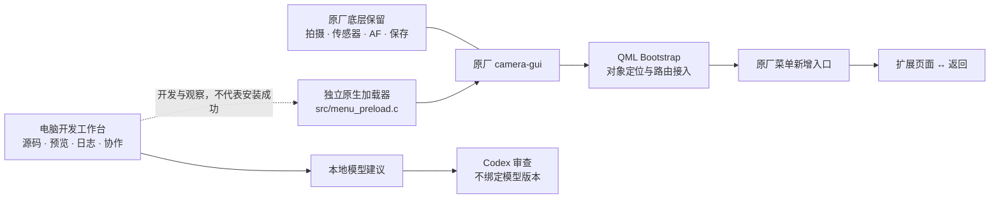
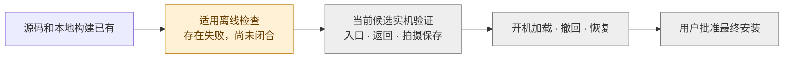

# X2D II 开发工作台与菜单扩展

把现有成果放在一处：**实际源码、系统关系、失败记录、经验与尚未完成的部分**。

这是研究和开发快照，不是可刷机固件。当前菜单候选尚未完成实机验收，本仓库不提供安装包，也不宣称连拍或对焦性能已经提升。

## 一眼看懂现在做到了什么

| 部分 | 已有成果 | 还缺什么 |
| --- | --- | --- |
| 原厂菜单扩展 | 独立“扩展”入口、页面、返回与原菜单路由保留的代码；已有桌面 Qt 检查记录 | 当前候选在相机上的实际进入、操作与返回 |
| 原生加载 | 精确原厂 GUI / Qt 编译单元约束、独立加载器、宿主缓存桥 | 当前 ARM64 机身加载验证 |
| 部署 / 开机加载 / 撤回 | 对应代码、内容绑定、恢复与离线行为测试 | 未闭合的电脑端流程失败，以及实机开机、撤回和官方恢复 |
| 本地工作台 | 相机识别、源码查看、草稿、任务板、桌面预览、本地模型队列、实时日志时间线 | 当前连接与运行状态需实测；桌面预览不等于机身 |
| 历史研究 | 上机与官方回退的历史事实、RAW 保存 / 缓存所有权研究、永久回归要求 | 不把历史版本结果当成当前候选证明 |
| 高速连拍 / AF 优化 | 保留需求和研究线索 | 本菜单候选没有实现 16-bit 3fps 或 14-bit 6/9fps，也没有实现 AF 性能升级 |

## 系统结构



这里的箭头表示设计和已有实现关系，不代表全部已在本候选的机身上运行。

## 当前卡在哪里



2026-10-12 整理时，既有全量电脑检查的最新日志显示到 **48%**，已有 **14 份失败记录**，没有最终审计回执。这是检查的历史快照，不是动态进度，也不是相机故障数量。[详细状态](docs/STATUS.md)列出每组失败的实际边界。

## 从哪里看

- [成果与证据边界](docs/STATUS.md)：哪些已实现，哪些只在电脑验证，哪些失败，哪些没做。
- [项目地图](docs/ARCHITECTURE.md)：代码与七个系统部分对应关系。
- [经验和教训](docs/LESSONS.md)：反复出错的原因，以及接手时应保留的判断。
- [参考项目与许可](docs/REFERENCES.md)：借鉴来源、固定提交和机型差异。
- [快照范围与运行条件](docs/SNAPSHOT.md)：为什么不上传照片、原厂固件和私人日志。
- [工作台说明](devtools/README.md)：已有功能和实际限制。
- [源码及证据哈希清单](SNAPSHOT_MANIFEST.json)：上传内容与本地源文件逐项对应。

## 目录

```text
src/                 原生加载器、桌面宿主桥
qml/                 菜单模型、接入层、扩展页面
tools/               构建、部署衔接、加载、恢复与读回代码
tests/               现有离线测试源码，不代表已通过
devtools/            本地网页工作台、插件、本地模型和时间线
research/drafts/     最新本地修正草稿，未合并 / 未执行状态保留
research/records/    原有计划与永久回归记录的快照
docs/                可读成果地图、状态和教训
```

原始正式源码按字节保留，不顺手改写；最新草稿单独保存，不伪装成已进入正式版本。旧工程原样冻结，没有复制旧系统树或镜像。

## 运行边界

工作台入口是 `devtools/app.py`；主服务仅使用 Python 标准库，绑定本机回环地址。其桌面 Qt 预览、原厂代码视图、机内通道和完整回归另有未打包输入，详见 [快照说明](docs/SNAPSHOT.md)。本仓库不是脱离原厂材料即可一键构建和上机的完整发行包。

该项目不是 Hasselblad 或 OpenAI 官方产品。参考代码的 MIT 声明保留在 [THIRD_PARTY_NOTICES.txt](THIRD_PARTY_NOTICES.txt)。
