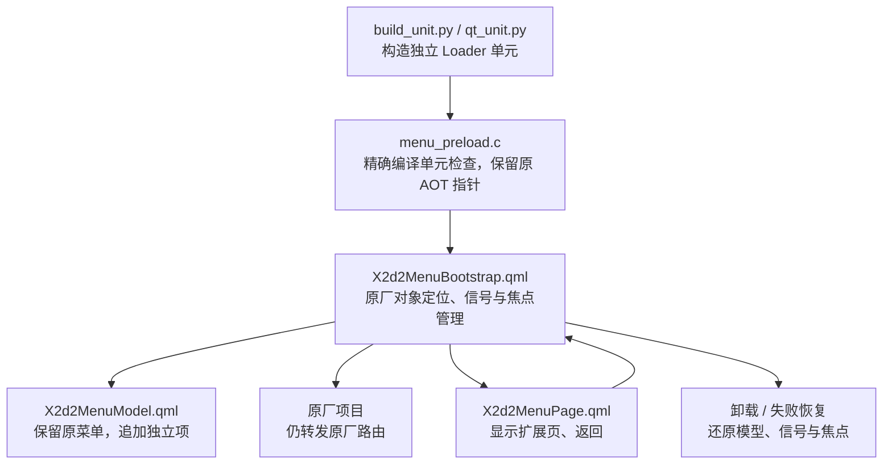
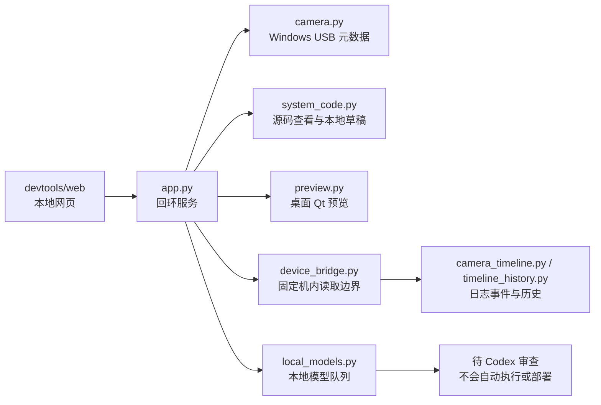

# 项目地图

## 相机七部分与当前工作

| 系统部分 | 本项目对应源码 | 当前介入程度 |
| --- | --- | --- |
| 界面与菜单 | `qml/`、`src/menu_preload.c`、`tools/build_unit.py` | 实现独立入口与页面；机身验收待完成 |
| 拍摄控制 | 工作台分类与历史研究 | 当前候选不改曝光 / 连拍控制 |
| 硬件采集与控制 | 工作台分类与历史研究 | 当前候选不改传感器、DMA、镜间快门 |
| 图像与算法 | 工作台分类与历史研究 | 当前候选不改 ISP、AI / AF、校准 |
| 保存与持久化 | `tools/boot_config.py`、`tools/menu_boot_*` | 只处理扩展加载配置，不改 RAW → 3FR |
| 基础系统 | `tools/menu_host_process.py`、`tools/menu_owned_cleanup.py` 等 | 管理已限定的扩展 / GUI 生命周期与恢复 |
| 通信与维护 | `tools/live_readout.py`、`tools/menu_*transport.py`、`devtools/device_bridge.py` | 既有通道适配及固定操作，不提供任意命令网页接口 |

## 菜单接入责任

Loader、页面、菜单模型和信号卸载都有各自责任。新增菜单标签不等于新增后端功能；桌面控制可点击不等于机身路径已成立。

## 工作台

USB 设备被识别 ≠ 机内读取可用 ≠ 可写代码 ≠ 可安装。工作台不会因为显示“连接”而自行开放后续权限。

时间线来自固定日志新增字节，不是传感器、DSP、JLS与SSD全函数探针；事件时间相近不能强行视作同一张照片。
